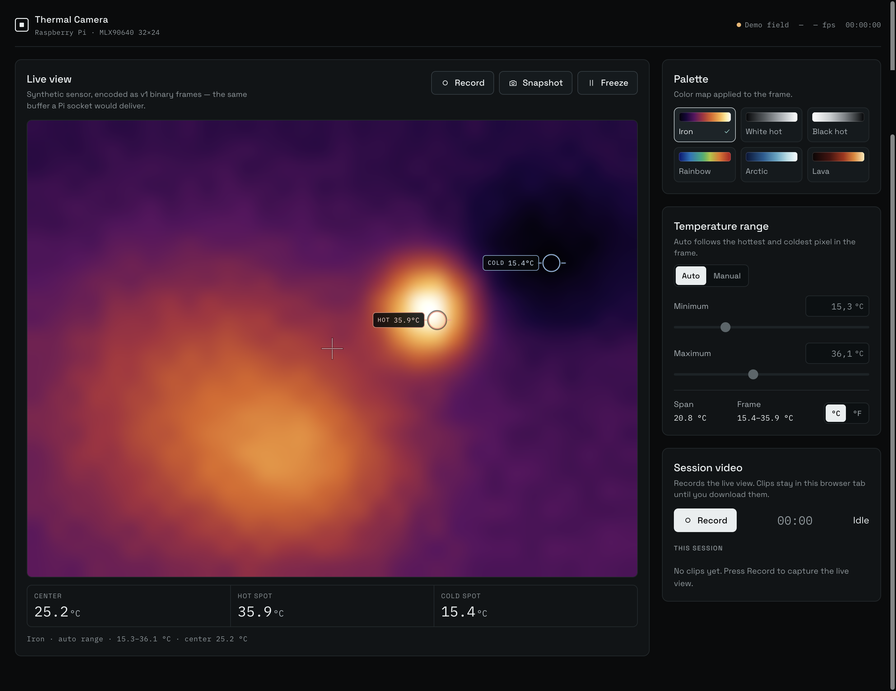
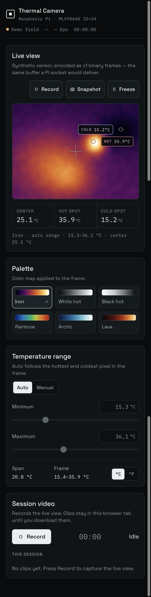

# Temperature Camera Streaming Server

[](https://github.com/bezineb5/temperature-camera/actions/workflows/tests.yml)
[](LICENSE)
[](requirements.txt)

A Flask-based thermal camera server. The Raspberry Pi sends raw MLX90640 temperature
frames to the browser over a binary WebSocket (stream contract v1); the browser does all
rendering and recording.



## How it works

`MLX90640 (32×24 °C) → main.py encodes v1 binary frames → ws://<pi>:5000/ws/thermal → browser canvas`

Calibration stays on the Pi; palette, temperature range, °C/°F, spot markers,
snapshots and clips are all client-side. The wire format is specified in the
[stream contract](templates/stream-contract.html), also served live at
`/stream-contract.html`.

## Contents

- [Features](#features)
- [Hardware Requirements](#hardware-requirements)
- [Software Requirements](#software-requirements)
- [Quick Start](#quick-start-no-hardware-needed)
- [Installation](#installation)
- [Usage](#usage)
- [Configuration](#configuration)
- [Development](#development)
- [File Structure](#file-structure)
- [Troubleshooting](#troubleshooting)
- [Screenshots](#screenshots)
- [License](#license)
- [Support](#support)

## Features

- Real-time thermal frames as v1 binary WebSocket messages (1,568 bytes/frame, 12 fps default)
- Client-side palettes (iron, white hot, black hot, rainbow, arctic, lava), auto/manual
  temperature range, °C/°F, hot/cold spot markers
- Browser-side snapshots (PNG) and session clips (WebM via MediaRecorder)
- Stream contract page served at `/stream-contract.html`
- Demo mode (`--demo`) streams a synthetic field without hardware
- Systemd service for production deployment

## Hardware Requirements

- Any Raspberry Pi with I2C and a network connection — Pi Zero 2 W, 2, 3, 4 or 5
  (the original Pi Zero also works headless; Wi-Fi needs a USB dongle)
- MLX90640 Thermal Camera Sensor

## Software Requirements

- Python 3.11+ (Raspberry Pi OS Bookworm ships 3.11, Trixie 3.13; older versions are EOL)
- Raspberry Pi OS, 32-bit or 64-bit — the server only streams ~19 kB/s, either works
- I2C enabled

## Quick Start (no hardware needed)

```bash
git clone https://github.com/bezineb5/temperature-camera.git
cd temperature-camera
pip install -r requirements.txt
python3 main.py --demo
# Open http://localhost:5000 — shows a synthetic thermal field
```

## Installation

### 1. System Setup

```bash
# Update system
sudo apt-get update && sudo apt-get upgrade -y

# Install dependencies (libgpiod-dev/python3-dev are needed to build the
# gpiod wheel on the Pi if no prebuilt wheel matches its architecture)
sudo apt-get install -y python3-pip python3-venv python3-dev libgpiod-dev

# Enable I2C
sudo raspi-config
# Navigate to: Interface Options -> I2C -> Enable

# Optional: raise the I2C baud rate. 1 MHz is the MLX90640 maximum, but marginal
# wiring often fails at that speed — if reads fail with "Too many retries",
# remove this line and reboot (see Troubleshooting)
echo "dtparam=i2c_arm_baudrate=1000000" | sudo tee -a /boot/firmware/config.txt

# Reboot
sudo reboot
```

### 2. Python Dependencies

For development mode (Options A/B), system-wide pip is fine:

```bash
pip3 install -r requirements.txt
pip3 install -r requirements-pi.txt   # Raspberry Pi only
```

For the systemd service (Option C) the unit runs `venv/bin/python`, so the Pi
needs a virtualenv at `TemperatureCamera/venv` — create it from your machine
with `make setup-venv`, which also installs both requirements files into it.

### 3. Deployment Options

#### Option A: Development Mode

```bash
python3 main.py
# Access at http://localhost:5000
```

#### Option B: Demo Mode (no hardware needed)

```bash
python3 main.py --demo
# Streams a synthetic thermal field; the UI also falls back to it
# automatically whenever the socket is unreachable
```

#### Option C: Production Deployment (Recommended)

The service expects a venv on the Pi, so the order matters:

```bash
make setup-venv         # on the Pi: create venv + install requirements.txt and requirements-pi.txt
make deploy             # push code from this machine
make service-install    # install + enable the systemd unit on the Pi
make service-start

# Service management commands
make service-stop       # Stop the service
make service-restart    # Restart the service
make service-status     # Check service status
make service-logs       # View logs (journalctl)
make service-update     # Deploy latest code, reinstall unit, restart
```

## Usage

### Web Interface

- **Live view**: `http://<raspberry-pi-ip>:5000/`
- **Stream contract**: `http://<raspberry-pi-ip>:5000/stream-contract.html`

### API Endpoints

#### Server Status
```bash
GET /api/status
# => {"source": "mlx90640"|"demo", "clients": N, "seq": ..., "fps": ..., "fault": ..., "settings": {...}}
```

#### Thermal Frame Stream (WebSocket)

`ws://<raspberry-pi-ip>:5000/ws/thermal` — one binary v1 frame per message
(32-byte header + 32×24 int16 hundredths-°C, see the stream contract). Text
messages are the control channel: `{"type":"ping","id":7}` → `{"type":"pong","id":7}`,
and `{"type":"settings","emissivity":0.95,"reflectedC":21.0}` to update the
physical model on the Pi.

## Configuration

Command-line options for `main.py`:

- `--demo`: stream a synthetic thermal field instead of the sensor
- `--host` / `--port`: bind address (default `0.0.0.0:5000`)
- `--fps`: stream rate in frames per second (default: 12)

Stream constants (protocol version, header layout, 32×24 grid, 1,568-byte
frames) live at the top of `main.py` and mirror `/stream-contract.html`.

## Development

```bash
pip install -r requirements-dev.txt
make test                  # unit tests (no hardware needed)
python3 main.py --demo     # run the server without a sensor
```

## File Structure

- `main.py`: Flask server, v1 frame encoder, WebSocket hub, sensor/demo sources
- `templates/index.html`: Live view UI (canvas renderer, palettes, recording)
- `templates/stream-contract.html`: v1 stream contract served by the app
- `designs/`: Source design export the UI was built from
- `requirements.txt`: Python dependencies (any machine)
- `requirements-pi.txt`: Sensor library (Raspberry Pi only)
- `requirements-dev.txt`: Test runner (development machines)
- `tests/`: pytest unit tests
- `Makefile`: Deployment and venv setup
- `TemperatureCamera.service`: Systemd service configuration
- `docs/`: Screenshots
- `LICENSE`: MIT

## Troubleshooting

### I2C Issues
```bash
# Check if the MLX90640 is detected (expect 0x33)
sudo i2cdetect -y 1
```

- Logs show `Sensor read failed ... Too many retries`: the Pi opens `/dev/i2c-1`
  fine, but the sensor does not ACK — usually wiring/pull-ups, or the I2C baud
  rate pushed too high. Remove `dtparam=i2c_arm_baudrate=...` from
  `/boot/firmware/config.txt` and reboot; check the sensor is powered at 3.3 V
  (not 5 V).
- If `i2cdetect` shows nothing at all, check wiring and reboot.
- Startup fails with `Failed to initialize MLX90640: The platform library 'gpiod'
  was not found`: Blinka needs gpiod even for I2C-only use. Install
  `libgpiod-dev` (system setup above), then reinstall the Pi requirements into
  the venv: `make setup-venv`.

### Stream Issues
```bash
# Check server health and stream stats
curl http://localhost:5000/api/status

# Lower the stream rate if the network or client can't keep up
python3 main.py --fps 6
```

### Performance Issues
```bash
# Lower --fps if the client can't keep up (frames are dropped, never queued)
# Ensure proper cooling for Raspberry Pi
```

## Screenshots

<p align="center">
  
  
</p>

## License

MIT License — see [LICENSE](LICENSE).

## Support

For issues and feature requests, please open a GitHub issue. PRs welcome —
run `make test` first and keep the UI faithful to `designs/`.

## Acknowledgements

- Adafruit for the MLX90640 library
- Raspberry Pi Foundation for the excellent hardware platform
